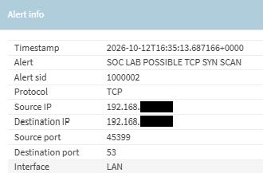
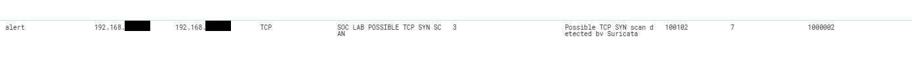
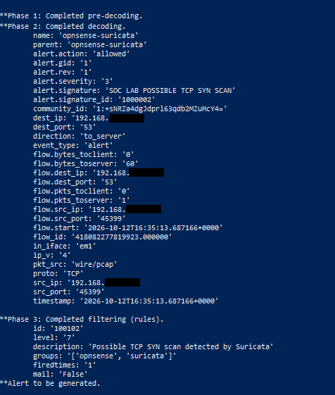

# Detection Report - TCP SYN Scan

## Summary

A controlled TCP SYN scan was performed inside the Home SOC Lab to validate detection of reconnaissance activity.

The scan was generated using Nmap against a lab gateway. Suricata detected the burst of TCP SYN packets and generated a custom alert, which was then forwarded to Wazuh and classified using a dedicated custom rule.

## Detection Source

Suricata custom rule:

```text
SID: 1000002
Signature: SOC LAB POSSIBLE TCP SYN SCAN
```

Wazuh rule:

```text
Rule ID: 100102
Level: 7
Description: Possible TCP SYN scan detected by Suricata
```

## Test Activity

The scan was generated using Nmap:

```powershell
nmap -sS 192.168.XX.XX
```

The `-sS` option performs a TCP SYN scan.

This type of scan sends SYN packets to multiple destination ports in order to identify open or filtered services.

## Detection Logic

The Suricata rule detects multiple TCP SYN packets originating from the same source within a short time window.

The detection flow is:

```text
Nmap SYN Scan
      |
      v
Multiple TCP SYN packets
      |
      v
Suricata threshold exceeded
      |
      v
Custom SID 1000002
      |
      v
EVE JSON Alert
      |
      v
Remote Syslog
      |
      v
Wazuh Decoder
      |
      v
Wazuh Rule 100102
      |
      v
Level 7 Alert
```

## Observed Event

The Suricata event contained fields including:

- event type: alert
- protocol: TCP
- signature ID: 1000002
- signature: SOC LAB POSSIBLE TCP SYN SCAN
- source port
- destination port
- flow information
- Suricata severity

Wazuh processed the event and generated a level 7 alert.

## Evidence

### Suricata Alert



### Wazuh Alert



### Decoder and Rule Validation



## Analysis

The activity matched the expected behavior of a TCP SYN scan.

A large number of SYN packets were generated from one source toward multiple destination ports within a short period of time.

This pattern is commonly associated with network reconnaissance.

The scan was performed intentionally as part of a controlled lab test.

## Classification

```text
Type: Network reconnaissance
Technique: TCP SYN scanning
Risk: Medium
Expected activity: Yes - controlled lab test
Response required: No
```

## Detection Assessment

The detection successfully identified the scan and produced a dedicated SIEM alert.

The test confirmed that:

- Suricata inspected the relevant traffic
- the custom threshold rule triggered
- the alert was generated as EVE JSON
- remote logging delivered the event
- Wazuh decoded the structured event
- the dedicated custom rule matched SID 1000002
- a higher severity alert was generated than for the ICMP validation test

## Potential SOC Response

If this activity was not expected, an analyst could:

1. identify the source system
2. review the number of targeted ports
3. determine whether the source is authorized
4. check for additional reconnaissance activity
5. correlate the event with endpoint telemetry
6. review subsequent connection attempts
7. block or isolate the source if required

## False Positive Considerations

Possible legitimate sources of similar traffic include:

- vulnerability scanners
- asset discovery systems
- administrator troubleshooting
- monitoring tools
- authorized penetration testing

Context is therefore required before escalating the event as malicious.

## Conclusion

The controlled TCP SYN scan was successfully detected by the Home SOC Lab.

The test demonstrated an end-to-end detection workflow:

```text
Nmap
→ Suricata
→ EVE JSON
→ rsyslog
→ Wazuh
→ Custom Rule
→ Alert
```

This detection can later be reused during Red Team / Purple Team exercises to validate reconnaissance visibility.
