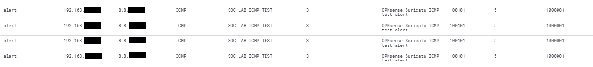

# Wazuh SIEM / XDR

## Purpose

Wazuh is used as the central SIEM/XDR platform in the Home SOC Lab.

It collects endpoint telemetry, receives network security events and applies custom decoding and detection logic.

The main goals are to:

- centralize security logs
- monitor Windows endpoints
- ingest Suricata alerts
- parse structured JSON events
- create custom detection rules
- investigate security events
- visualize alerts in the Wazuh Dashboard

## Role in the Lab

Wazuh acts as the central monitoring platform.

Current data sources include:

- Windows Wazuh Agent
- Sysmon
- OPNsense remote logs
- Suricata EVE JSON
- rsyslog
- custom local detections

The overall flow is:

```text
Windows Endpoint
      |
      v
 Wazuh Agent
      |
      v
    Wazuh
      ^
      |
Suricata / OPNsense
      |
      v
   rsyslog
```

## Windows Agent

A Wazuh Agent is installed on the monitored Windows endpoint.

The agent forwards endpoint telemetry to the Wazuh Manager.

The endpoint is used for:

- process monitoring
- network connection monitoring
- registry monitoring
- DNS monitoring
- file creation monitoring
- controlled detection testing

## Sysmon Integration

Sysmon is installed on the Windows endpoint to provide detailed security telemetry.

Important Event IDs currently monitored include:

```text
Event ID 1  - Process Creation
Event ID 3  - Network Connection
Event ID 10 - Process Access
Event ID 11 - File Creation
Event ID 12 - Registry Object Create/Delete
Event ID 13 - Registry Value Set
Event ID 14 - Registry Object Rename
Event ID 22 - DNS Query
```

These events provide significantly more visibility than standard Windows event logging alone.
### Evidence

Example Sysmon Process Create event collected by Wazuh:


## Suricata Integration

Suricata events are forwarded from OPNsense using remote syslog.

The Ubuntu server receives these logs using rsyslog.

The flow is:

```text
OPNsense
   |
   v
Suricata
   |
   v
EVE JSON
   |
   v
Remote Syslog
   |
   v
rsyslog
   |
   v
Wazuh
```

Wazuh reads the Suricata events and applies custom decoding and detection logic.

More information:

[Suricata documentation](../suricata/README.md)

## JSON Decoding

Suricata events are generated using the EVE JSON format.

A custom Wazuh decoder identifies Suricata events and uses JSON parsing to extract structured fields.

Examples of extracted fields include:

```text
src_ip
dest_ip
proto
event_type
alert.signature
alert.signature_id
alert.severity
```

This allows Wazuh rules to work with individual event fields instead of relying only on raw log text.

## Custom Decoder

A custom decoder was created for Suricata events received through OPNsense.

The decoder identifies the Suricata process and passes the JSON payload to Wazuh's JSON decoder.

Conceptually:

```text
Syslog Event
    |
    v
Suricata Process Match
    |
    v
JSON Decoder
    |
    v
Structured Fields
```

The full production configuration is stored separately in the private backup repository.

Only sanitized documentation is published here.

## Custom Wazuh Rules

Custom Wazuh rules were created to classify Suricata alerts.

### Base Suricata Alert Rule

The base rule identifies decoded Suricata alert events.

```text
Rule ID: 100100
Purpose: Base Suricata alert classification
```

### ICMP Test Alert

```text
Rule ID: 100101
Purpose: Detect the custom Suricata ICMP test alert
Severity level: 5
```

This rule is linked to the Suricata custom detection:

```text
SID: 1000001
SOC LAB ICMP TEST
```
### Evidence

Wazuh alert generated from the custom Suricata ICMP detection:


### TCP SYN Scan Alert

```text
Rule ID: 100102
Purpose: Detect possible TCP SYN scanning activity
Severity level: 7
```

This rule is linked to the Suricata custom detection:

```text
SID: 1000002
SOC LAB POSSIBLE TCP SYN SCAN
```
### Evidence

Wazuh alert generated from the custom Suricata TCP SYN scan detection:


This creates a simple severity hierarchy:

```text
Generic Suricata Alert
        |
        v
     Level 3
        |
        +--> ICMP Test
        |     Level 5
        |
        +--> TCP SYN Scan
              Level 7
```

## Detection Validation

Custom rules were tested using `wazuh-logtest`.

This tool was used to verify:

- pre-decoding
- decoder matching
- JSON field extraction
- rule matching
- alert level
- rule description

A successful test produced:

```text
Phase 1 - Pre-decoding
Phase 2 - Decoding
Phase 3 - Rule filtering
```

This confirmed that the event could be processed correctly before testing it live.
### Evidence

Validation of the custom Suricata decoder and Wazuh rule using `wazuh-logtest`:


## Live Alert Testing

After validating the rules with `wazuh-logtest`, controlled traffic was generated inside the lab.

Examples include:

```text
ICMP traffic
TCP SYN scanning
```

The resulting events were:

1. detected by Suricata
2. forwarded using EVE JSON
3. received by rsyslog
4. processed by Wazuh
5. matched against custom Wazuh rules
6. displayed as alerts in Wazuh

## Alert Pipeline

```text
Network Activity
      |
      v
   Suricata
      |
      v
   EVE JSON
      |
      v
   rsyslog
      |
      v
    Wazuh
      |
      v
Custom Decoder
      |
      v
 Custom Rule
      |
      v
 Wazuh Alert
```

## Wazuh Archives

During initial testing, Wazuh archives were enabled to verify raw event ingestion.

This was useful for troubleshooting and confirming that events were reaching the manager.

After testing, full JSON archiving was disabled to prevent unnecessary disk usage.

This provided practical experience with:

- log retention
- disk usage monitoring
- event archiving
- balancing visibility and storage requirements

## Vulnerability Detection

Wazuh Vulnerability Detection was tested during the lab setup.

The module successfully identified vulnerabilities on monitored systems.

Later, the module was disabled in the current lab environment to reduce storage usage and focus resources on SIEM and detection engineering tasks.

## Troubleshooting

Several issues were encountered during setup.

### Suricata events visible in archives but not as alerts

This indicated that Wazuh was receiving the logs correctly, but no matching decoder or rule existed.

The solution involved:

- creating a custom decoder
- enabling JSON decoding
- creating custom Wazuh rules
- validating them using `wazuh-logtest`

### No Phase 3 in wazuh-logtest

Initially only Phase 1 and Phase 2 were displayed.

The reason was that no detection rule matched the decoded event.

After creating the custom Suricata rule hierarchy, Phase 3 appeared correctly.

### Disk usage growth

During testing, full event archiving and Vulnerability Detection caused significant disk usage.

Troubleshooting included:

- identifying large Wazuh directories
- reviewing archive usage
- disabling unnecessary full event archiving
- cleaning historical raw archives
- disabling Vulnerability Detection for the current lab profile

This provided useful experience with Wazuh resource management.

## Security Considerations

The public repository intentionally does not contain:

- complete Wazuh configuration files
- authentication information
- API credentials
- private keys
- certificates
- full environment addressing
- complete private detection configuration

Full backups are stored separately in a private repository.

## Current Status

Completed:

- [x] Wazuh Manager installed
- [x] Windows Agent connected
- [x] Sysmon integrated
- [x] Suricata logs ingested
- [x] EVE JSON parsed
- [x] custom decoder created
- [x] custom Wazuh rules created
- [x] ICMP detection verified
- [x] TCP SYN scan detection verified
- [x] wazuh-logtest validation completed
- [x] live alerts verified
- [x] disk usage and archive retention reviewed

## Future Improvements

Planned improvements include:

- additional custom detection rules
- improved alert correlation
- detection deduplication
- suspicious PowerShell detection
- DNS anomaly detection
- authentication attack detection
- correlation between network and endpoint telemetry
- Red Team / Purple Team validation
