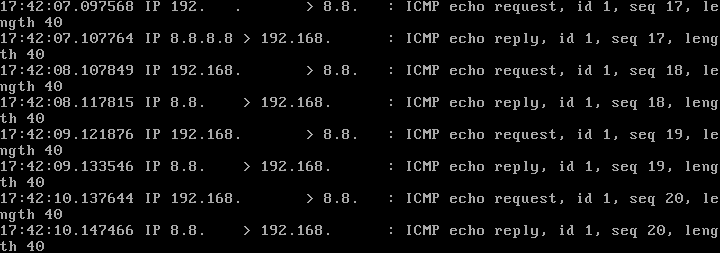
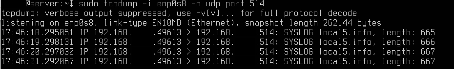
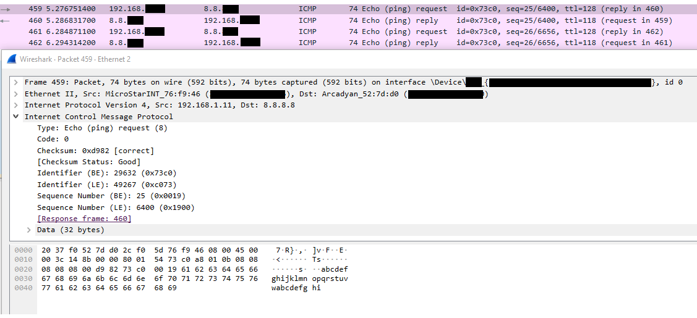
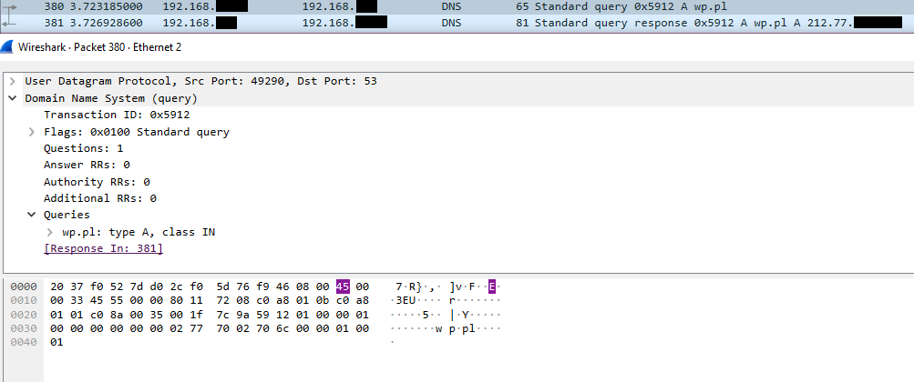
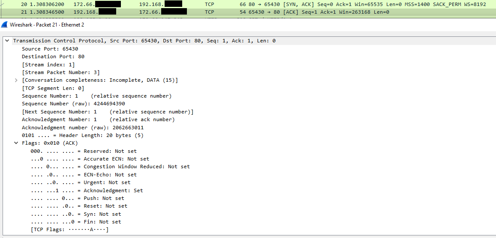
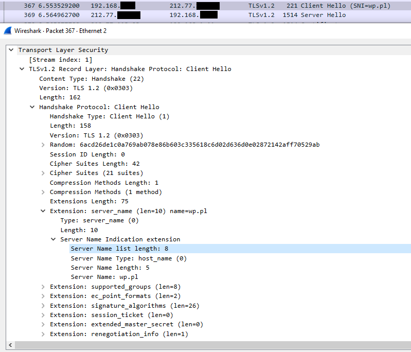

# Wireshark and tcpdump

## Purpose

Wireshark and tcpdump are used in the Home SOC Lab for packet capture, traffic inspection and troubleshooting.

They provide visibility into network traffic at packet level and are used to validate whether traffic reaches the expected interfaces and whether IDS alerts match the observed network activity.

## Role in the Lab

The tools are used for:

- packet capture
- protocol analysis
- traffic filtering
- troubleshooting connectivity
- verifying IDS visibility
- investigating suspicious traffic
- validating Suricata detections

## tcpdump

tcpdump is used primarily on Linux systems and network appliances for quick command-line packet inspection.

Typical use cases include:

- verifying whether traffic reaches an interface
- checking ICMP traffic
- checking DNS traffic
- monitoring remote syslog
- verifying Suricata traffic visibility
- validating communication between lab systems

Example ICMP capture:

```bash
sudo tcpdump -i 192.168.XX.XX -n icmp
```

Options:

- `-i` - selects the network interface
- `-n` - disables DNS and hostname resolution
- `icmp` - displays only ICMP traffic
### Evidence

ICMP traffic captured with `tcpdump` on the monitored lab interface:



Example remote syslog capture:

```bash
sudo tcpdump -i 192.168.XX.XX -n udp port 514
```

This was used during troubleshooting to verify that OPNsense was sending remote syslog traffic to the Ubuntu/Wazuh server.
### Evidence

Remote syslog traffic captured on the Ubuntu/Wazuh server:


## Wireshark

Wireshark is used for graphical packet analysis.

Captured traffic is used to inspect:

- packet source and destination
- protocols
- TCP sessions
- DNS queries
- ICMP traffic
- encrypted TLS traffic
- connection establishment

## Display Filters

Examples of filters used during analysis:

### ICMP Analysis Evidence

ICMP Echo Request / Echo Reply traffic inspected in Wireshark:
The screenshot below shows ICMP Echo Request and Echo Reply packets captured in Wireshark.

The packet details include the ICMP message type, sequence number and checksum, which can be used to verify basic network connectivity and analyze request/response behavior.



This capture demonstrates how ICMP traffic can be inspected at packet level.  
It confirms successful request/response communication and shows metadata such as message type, sequence number and TTL.

### DNS Analysis Evidence

The screenshot below shows a DNS query and response captured in Wireshark.

The packet details include the queried domain, query type, transaction ID and DNS response information.



This capture demonstrates how DNS traffic can be analyzed to identify name resolution activity.  
It shows how a client requests an IP address for a domain and how the DNS server returns the corresponding response.

### TCP traffic analysis

The screenshot below shows TCP communication captured in Wireshark.

The packet details include source and destination ports, sequence and acknowledgment numbers, and TCP flags such as SYN and ACK.



This capture demonstrates how TCP connection establishment and session state can be analyzed.  
The SYN, SYN-ACK and ACK packets illustrate the TCP three-way handshake used to establish a reliable connection.

### TLS traffic analysis

The screenshot below shows a TLS 1.2 Client Hello packet captured in Wireshark.

It includes the handshake type, cipher suites and Server Name Indication (SNI), which identifies the requested hostname during encrypted communication.



This capture demonstrates that even though the application payload is encrypted, useful metadata is still visible.  
Wireshark can reveal the TLS version, handshake type, supported cipher suites and SNI.

### Specific host

```text
ip.addr == 192.168.XX.XX
```

## Follow TCP Stream

Wireshark's **Follow TCP Stream** feature is used to reconstruct communication belonging to a single TCP session.

This helps with:

- understanding client-server communication
- identifying application-level data
- troubleshooting connectivity
- reviewing unencrypted protocol traffic

## PCAP Workflow

Packet captures were also created using tcpdump and later analyzed in Wireshark.

Example workflow:

```text
Network Traffic
      |
      v
   tcpdump
      |
      v
  PCAP file
      |
      v
Transfer to workstation
      |
      v
  Wireshark
      |
      v
Packet Analysis
```

This provides experience with both command-line and graphical packet analysis.

## IDS Troubleshooting

tcpdump was particularly useful while configuring Suricata.

When IDS alerts were missing, packet capture was used to verify whether traffic was actually reaching the monitored network interface.

The troubleshooting process followed:

```text
Generate traffic
      |
      v
Capture packets
      |
      v
Confirm interface visibility
      |
      v
Check Suricata
      |
      v
Check EVE JSON
      |
      v
Check Wazuh
```

This helped separate network problems from IDS or SIEM configuration problems.

## Remote Syslog Troubleshooting

During the OPNsense to Wazuh integration, tcpdump was used to inspect remote syslog traffic.

This allowed verification of:

- UDP transport
- destination port
- source translation caused by virtualization
- packet delivery to the Ubuntu server

This was useful for identifying why the initial rsyslog filtering rule did not match incoming traffic.

## Skills Practiced

The packet analysis work provided practical experience with:

- packet capture
- protocol filtering
- TCP/IP analysis
- DNS inspection
- ICMP analysis
- TLS traffic identification
- PCAP handling
- network troubleshooting
- IDS validation
- command-line traffic analysis

## Security Considerations

The public repository does not contain packet captures from the real home network.

Only sanitized examples and screenshots from controlled lab traffic will be included.

This avoids exposing:

- host addresses
- internal service information
- DNS history
- session data
- potentially sensitive payloads

## Current Status

Completed:

- [x] tcpdump installed and tested
- [x] ICMP traffic captured
- [x] network traffic saved as PCAP
- [x] PCAP transferred for analysis
- [x] Wireshark installed
- [x] DNS filtering tested
- [x] ICMP filtering tested
- [x] TCP analysis performed
- [x] TLS traffic inspected
- [x] Follow TCP Stream tested
- [x] remote syslog troubleshooting performed
- [x] Suricata traffic visibility verified

## Future Improvements

Planned improvements include:

- documenting example PCAP investigations
- analyzing suspicious DNS traffic
- comparing normal and malicious traffic patterns
- analyzing Red Team traffic generated from Kali Linux
- correlating packet captures with Suricata and Wazuh alerts
